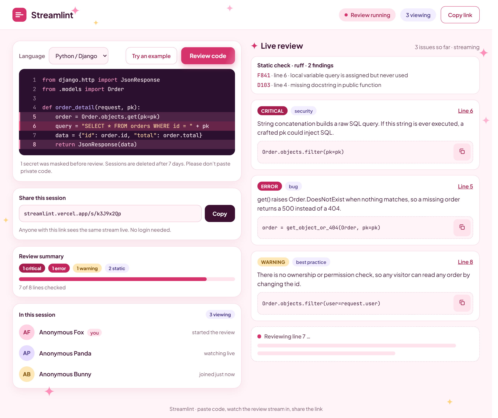
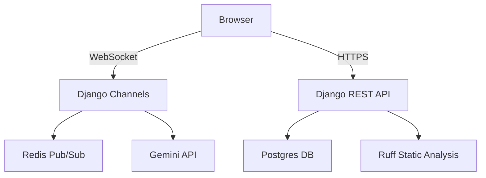

<div align="center">
  
  <span style="font-size: 2em; font-weight: bold; vertical-align: middle;">Streamlint</span>
</div>

<p align="center">
  <a href="https://streamlint.vercel.app">
    
  </a><br>
  <a href="https://github.com/Ruchika402/streamlint/actions">
    
  </a>
  <a href="https://opensource.org/licenses/MIT">
    
  </a>
</p>

<p align="center">
  
</p>

## ✨ What is Streamlint?
Streamlint is a real-time AI code reviewer. Paste your Python, Java, C++, or Go code, and watch as static analysis (Ruff) and AI-generated issues (Gemini) stream into your browser line-by-line. Share the link, and anyone can watch the review happen live.

## 🎯 Features
- **Real-time Streaming:** Issues appear one by one as the AI generates them.
- **Shared Sessions:** Anyone with the link sees the same live stream instantly.
- **15 Languages Supported:** Python, Django, JavaScript, Java, C, C++, C#, Go, Rust, Ruby, PHP, HTML, Swift, R, and SQL.
- **Safety First:** Rate limits, secret redaction, Cloudflare Turnstile, and a daily budget breaker.
- **Zero Friction:** No login required. A secure, unguessable token is the key.

## 🏗️ Architecture



## 🛠️ Stack

- **Backend:** Django + Channels (ASGI), Redis (Upstash), Postgres (Neon), Gemini API (free tier)
- **Frontend:** React + TypeScript (Vite), CodeMirror 6
- **Hosting:** Render (Backend), Vercel (Frontend)
- **CI:** GitHub Actions


## ⚡How it Works

- **Paste Code:** You paste your code and select a language.
- **Ruff Pre-pass:** Ruff runs instantly to find syntax errors and style issues.
- **AI Review:** Gemini streams its review line-by-line over a WebSocket.
- **Live Share:** Every event is saved to Redis and broadcast to all connected viewers.
- **Replay:** Late joiners get the full history instantly.

## 🏃 Quick Start (Docker)

```bash
git clone https://github.com/Ruchika402/streamlint.git
cd streamlint
docker compose up --build
```

## 📚 Documentation

- [Chaos Testing Report](docs/CHAOS.md)
- [Runbook](docs/RUNBOOK.md)
- [Threat Model](docs/THREAT_MODEL.md)

## ⚠️ Limitations

- **Free Tier:** The backend runs on Render's free tier, which spins down after 15 minutes of inactivity. The first request after a break may take approximately 50 seconds to wake up.
- **AI Quota:** The free Gemini API has a daily limit of 20 requests. We use a budget breaker to help prevent hitting this limit.

## 📝 License

This project is licensed under the **MIT License**.
